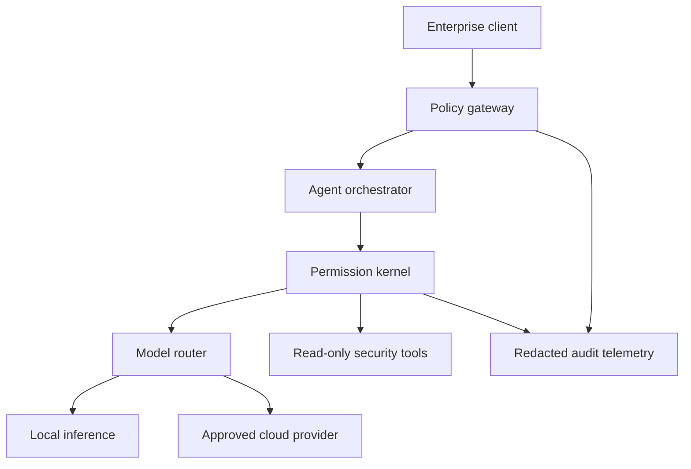

# Architecture

Trust boundaries: client identity, agent sandbox, local runtime and external providers. Default deny; external transfer requires explicit policy. Treat model output and retrieved content as untrusted. Separate control and data planes. Use synthetic fixtures first.

ADR-001: Start with a modular monolith and explicit interfaces; distribute only after measurements justify complexity.
